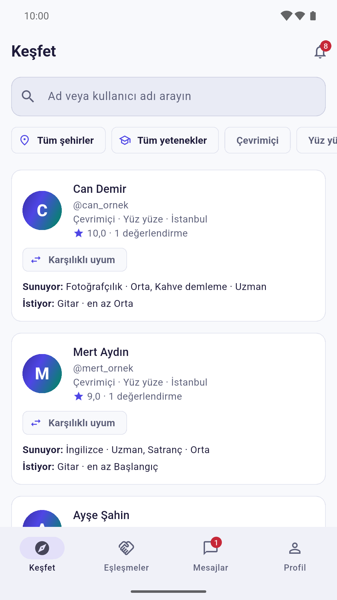
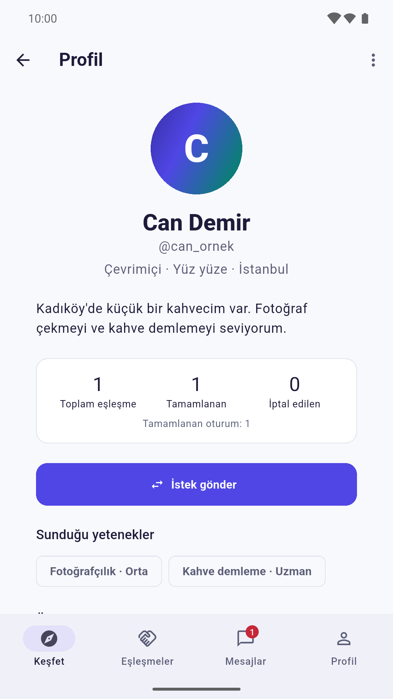
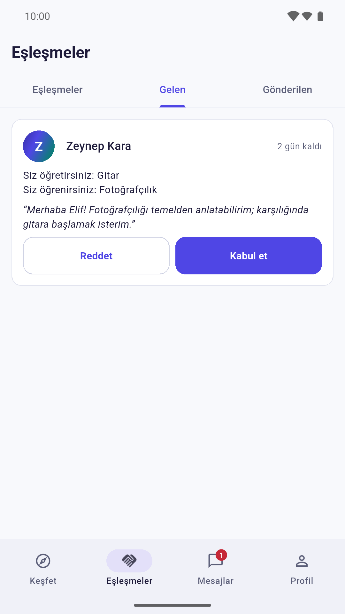
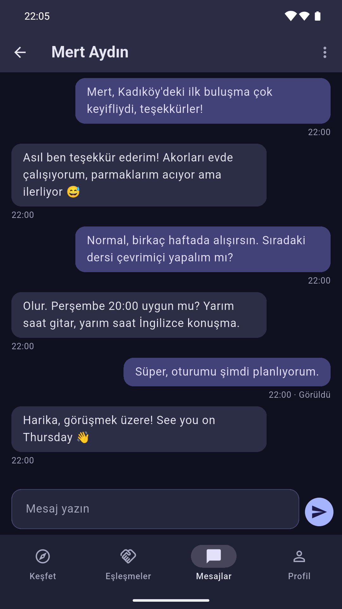
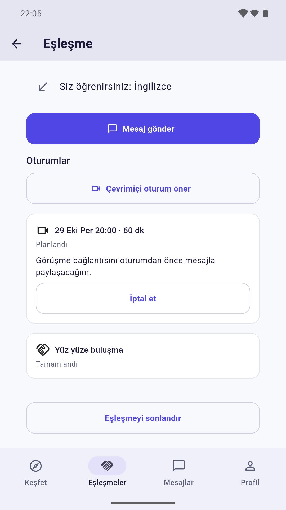
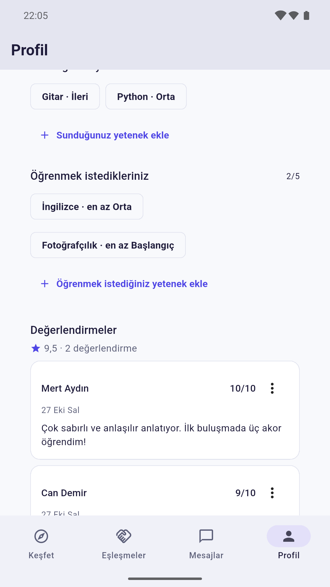
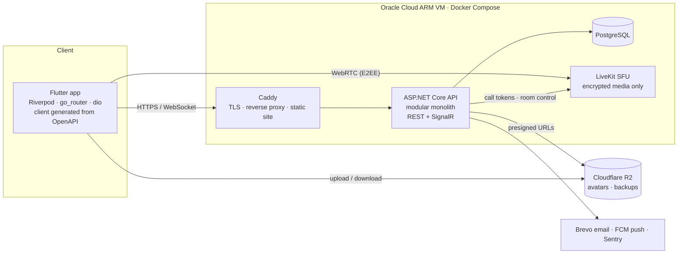

# Exparter

**A skill-swap platform: teach what you know, learn what you don't.**

Someone who plays the guitar and wants to learn English finds someone who teaches English and wants to learn the guitar. They match, chat, schedule online sessions, meet on an end-to-end encrypted video call inside the app, and rate each other afterwards. No money changes hands, only skills.

Exparter was built end to end as a production-grade product: an API-first .NET backend, a Flutter Android app, a self-hosted deployment with CI/CD, and a closed beta on Google Play with real users. The interface is in Turkish; code, comments and commits are in English.

> **Status:** showcase project. The Android app ran a closed beta on Google Play (Nov 2026) against a live backend. Development is complete for the scope below; the remaining ideas are listed under [Roadmap](#roadmap-not-built).

| Discover | Profile | Swap request | Chat | Sessions | Reviews |
|---|---|---|---|---|---|
|  |  |  |  |  |  |

## Features

- **Accounts:** sign-up with email verification, password reset over deep links, JWT access tokens with rotating refresh tokens and reuse detection, account deletion with a grace period.
- **Profiles and skills:** avatar upload straight to S3-compatible storage with presigned URLs, a curated skill catalog with user proposals and admin review, offered and wanted skills with levels.
- **Discovery:** mutual-compatibility ranking (what you offer is what they want, and the other way round), then rating and recency; filters by city, category and skill; name search; cursor pagination over a dedicated read model.
- **Swap requests and matches:** request notes, cooldowns after rejection or expiry, a limit on concurrent matches, ending a match by mutual agreement.
- **Real-time messaging:** SignalR hub, read receipts, unread badges, push notifications through FCM when the app is in the background.
- **Sessions:** proposing, accepting and cancelling online sessions with overlap checks for both people, reminders, completion confirmed by both sides.
- **Video calls:** self-hosted LiveKit; the call opens 10 minutes before the session and closes 15 minutes after it ends; screen sharing; audio keeps running in the background through an Android foreground service.
- **End-to-end encrypted calls:** devices agree on a key with X25519 + HKDF and LiveKit frame encryption; the server only relays encrypted media. Both sides see the same 6-digit safety code to compare.
- **Reviews and stats:** ratings with comments after the first completed session; completed and cancelled match counts on profiles.
- **Moderation:** reporting users, messages and reviews; blocking; suspensions; admin tooling.
- **Product polish:** light and dark themes, in-app updates from Google Play, localized error messages that never show raw server text, loading, empty and error states on every screen.
- **Compliance:** KVKK (Turkish GDPR) privacy notice, terms of use with versioned acceptance, retention rules for reports and access logs, data deletion on account removal.

## Architecture



- **API-first.** [`contracts/openapi.yaml`](contracts/openapi.yaml) is the single source of truth. Every endpoint is defined there first, linted in CI, and the mobile API client is generated from it, never written by hand.
- **Modular monolith.** One deployable backend with nine modules (`Identity`, `Profiles`, `Skills`, `Matching`, `Messaging`, `Sessions`, `Reviews`, `Notifications`, `Moderation`). Modules don't touch each other's tables; they talk through application services and domain events. No microservices, no event sourcing ([ADR 0001](docs/adr/0001-modular-monolith.md)). The discovery read model is the one documented exception ([ADR 0011](docs/adr/0011-discovery-read-model.md)).
- **Clean Architecture.** `Domain` has no external dependencies and holds rich entities with closed setters and the business rules; `Application` holds commands, queries and validation (`Mediator` source generator, FluentValidation); `Infrastructure` holds EF Core, storage, email, push and LiveKit; `Api` holds endpoints, SignalR and ProblemDetails (RFC 9457) error mapping.
- **Vertical slices.** Each feature was built end to end: contract → backend → tests → mobile screen.
- **Client-agnostic backend.** Nothing in the API assumes a mobile client, so a web client can use the same endpoints and hub.

Every significant decision is recorded as an ADR in [`docs/adr/`](docs/adr/): authentication strategy, object storage, email deep links, push notifications, error tracking, deployment, video calls and call encryption among them.

## Tech stack

| Area | Choices |
|---|---|
| Backend | .NET 10, ASP.NET Core, EF Core, PostgreSQL, SignalR, Mediator (source-generated), FluentValidation, Serilog |
| Mobile | Flutter, Riverpod (codegen), go_router, dio, freezed, swagger_parser, flutter_secure_storage, livekit_client, cryptography |
| Real time | SignalR for chat and live updates, Firebase Cloud Messaging for background push, LiveKit for video |
| Storage | S3 API behind `IObjectStorage`: Garage locally, Cloudflare R2 in production |
| Infrastructure | Docker Compose on an Oracle Cloud ARM VM, Caddy with automatic TLS, nightly database backups copied to R2 |
| CI/CD | GitHub Actions: contract lint, build and tests on every push; images to GHCR; automatic rollout with migrations on merge to `main` |
| Observability | Sentry for the API and the app (EU region, no IP addresses, user id only), structured JSON logs |
| Security | Rate limiting, request and hub message size limits, security headers, weekly NuGet vulnerability audit |

## Quality

- **~550 backend tests:** domain unit tests, a unit test for every command handler, and API integration tests against a real PostgreSQL in Testcontainers for every endpoint.
- **~270 mobile tests:** widget and provider tests, plus an end-to-end integration test on an emulator against the real backend: sign-up, email verification, profile, skills, a swap request, a match and a completed session (the second user is driven through the API).
- **Measured performance work:** an N+1 query counter in tests, and discovery p50 latency cut from 1354 ms to 270 ms on a 10,000-user dataset.

## How it was built

I built Exparter with an AI coding agent (Claude Code) doing most of the implementation, while I acted as product owner, architect and tester. The aim was to find out how far a disciplined, AI-assisted workflow can take a single developer toward a real, shipped product.

- **Requirements first.** Before any code, I wrote a requirements document covering the product, the non-negotiable architecture, the stack and the delivery phases. Anything it left open was marked as an open question that only I could decide.
- **Plan, approve, build.** Every phase and every slice started with a written plan that I reviewed and approved. Each one ended with a summary, an updated roadmap and my sign-off before it was merged.
- **Decisions on record.** Product rules (who can interact with whom, match limits, review rules, what counts as a completed match) were my calls and are logged with dates in [`docs/domain/`](docs/domain/) and [`docs/roadmap.md`](docs/roadmap.md). Technical decisions are ADRs.
- **Guardrails over trust.** The contract-first rule, a test for every command handler and endpoint, and CI on every push kept generated code honest. Nothing was merged with failing tests.
- **Real-world verification.** I tried the slices in the running app on an emulator and on my own phone, and tested video calls and their encryption on two real devices. I set up the cloud, DNS, email, storage and store accounts, and ran the Google Play closed beta with real testers, whose feedback shaped later releases.

## Repository layout

| Path | Contents |
|---|---|
| [`contracts/`](contracts/) | OpenAPI contract |
| [`backend/`](backend/) | .NET solution: `Domain`, `Application`, `Infrastructure`, `Api` and three test projects |
| [`mobile/`](mobile/) | Flutter app, feature-first (`data/`, `domain/`, `presentation/` per feature) |
| [`deploy/`](deploy/) | Production Compose file, Caddyfile, LiveKit config, backup script, public website |
| [`docs/`](docs/) | ADRs, domain model, business rules, ERD, API conventions, deployment guide |

## Running it locally

Requirements: Docker Desktop, .NET 10 SDK, Flutter (stable) and an Android emulator.

```powershell
Copy-Item .env.example .env          # fill in the secrets as described in the file
docker compose up -d --wait          # PostgreSQL, Mailpit, Garage, LiveKit

cd backend
dotnet test                          # needs Docker (Testcontainers)
dotnet run --project src/Exparter.Api

cd ../mobile
flutter pub get
dart run swagger_parser
dart run build_runner build --delete-conflicting-outputs
flutter run
```

The backend reads its secrets from user-secrets. The full setup guide (in Turkish) is [`docs/development.md`](docs/development.md).

## Roadmap (not built)

These were planned and scoped, with their order and reasoning written down, but not built before the project was wrapped up:

| Idea | Scope |
|---|---|
| Trust score and badges | A trust indicator and badges on profiles, derived from completed matches, sessions and ratings |
| Files in chat | Images and documents (PDF, Word) for sharing notes and material, with type and size limits and reporting |
| Larger skill catalog | Subcategories, many more skills, catalog search, migration of existing user skills |
| Smarter recommendations | Discovery ranking that also weighs similar skills, trust, recent activity and location |
| In-app admin panel and moderators | Admin screens inside the app; admins grant a narrower moderator role, and every moderator action is audit-logged |
| Social feed | Text and image posts, later video; likes, comments and reporting |
| Sign in with Google | Plus Apple sign-in if an iOS app ships |
| English localization | App strings, emails and notifications in the user's language, translated catalog |
| Vibe tags | Up to three personality tags per profile from a fixed list of 24, used as a tie-breaker in discovery and shown when shared |
| Web client | A second client on the same API and SignalR hub |
| Memberships | Google Play Billing, with skill limits tied to the plan |

The detailed plan, including what was decided and why, is in [`docs/roadmap.md`](docs/roadmap.md) (Turkish).

## License

All rights reserved. The code is published for portfolio purposes.
