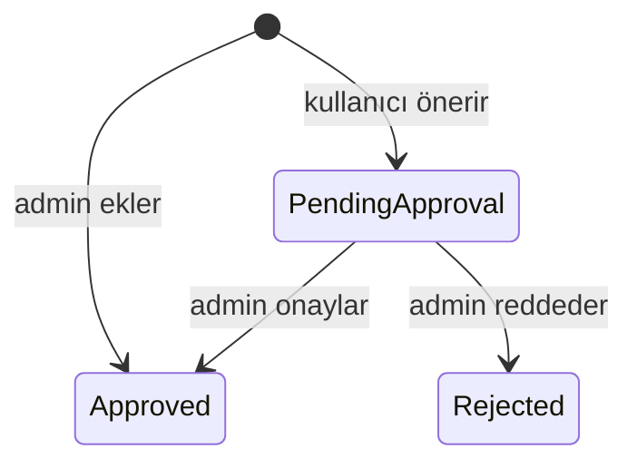
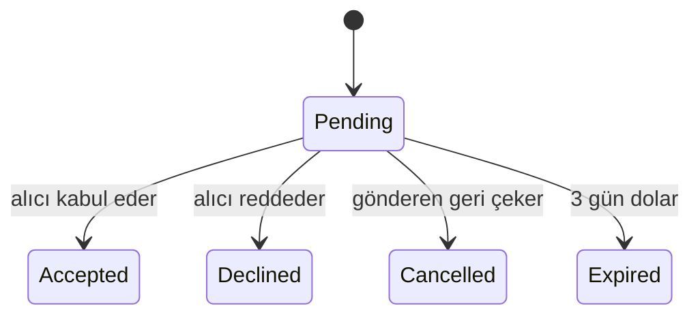
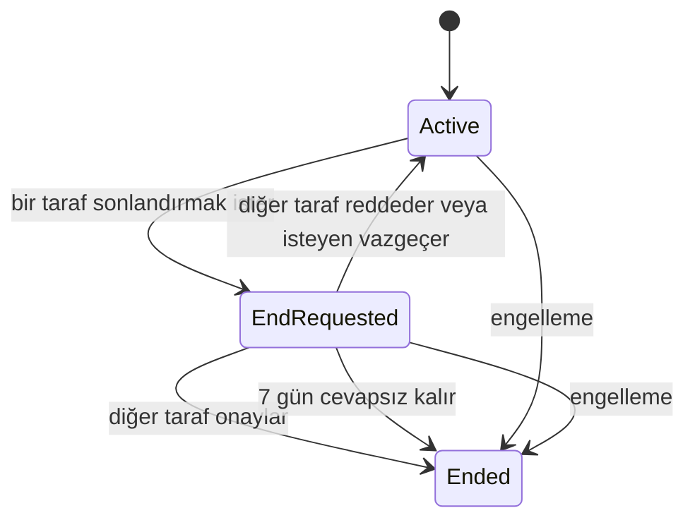
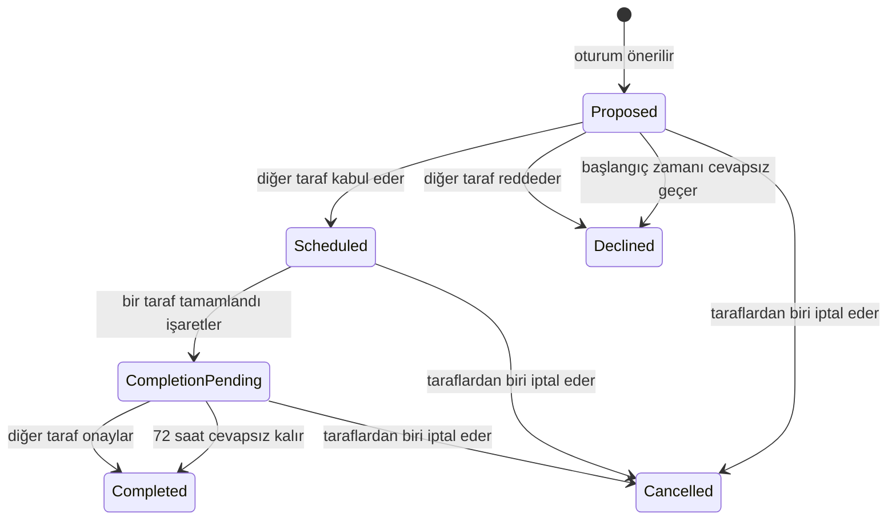

# Domain Modeli

Durum: **Onaylandı (2026-10-07).** Kararların dökümü `open-questions.md` dosyasındadır. Model uygulama sırasında gelişti; bu belge 2026-11-03'te koddaki haliyle eşitlendi. Tabloların tam listesi: `docs/erd/erd.md`.

Ortak kurallar:

- Tüm kimlikler `uuid`, tüm zamanlar UTC'dir.
- Bir modül başka bir modülün varlığını yalnızca kimliğiyle (`UserId`, `MatchId` ...) tanır. Modüller arası ilişkilerde navigation property yoktur.
- Her tablo tek bir modüle aittir. Başka modülün verisine ihtiyaç duyan modül, o modülün uygulama servisini çağırır veya domain event'ini dinler.

## 1. Identity

**`User`** (aggregate root)

| Alan | Açıklama |
|---|---|
| `Id` | |
| `Email` | Küçük harfe normalize edilir, benzersizdir. Kalıcı silmede yer tutucuyla değiştirilir. |
| `Username` | Benzersiz kullanıcı adı; yalnızca küçük harf, rakam, alt çizgi ve nokta. Girişte e-posta yerine kullanılabilir, diğer kullanıcılara görünür ve değiştirilebilir. Kalıcı silmede yer tutucuyla değiştirilir. |
| `PasswordHash` | |
| `Status` | `Active`, `Suspended`, `PendingDeletion`, `Deleted` |
| `Role` | `User`, `Admin`. Admin işlemleri MVP'de arayüzsüz endpoint'lerle yapılır. |
| `EmailVerifiedAt` | Boşsa e-posta doğrulanmamıştır. |
| `UsernameChangedAt` | Kullanıcı adının son değiştirildiği an. Sonraki değişiklik 7 gün sonra yapılabilir. |
| `AgeConfirmedAt` | Kullanıcının 18 yaş ve üstü olduğunu onayladığı an. Kayıtta zorunludur; doğum tarihi tutulmaz. |
| `TermsAcceptedAt`, `TermsVersion` | Kullanım koşullarının kabul anı ve kabul edilen sürüm (ID-09). |
| `CreatedAt` | |
| `DeletionRequestedAt` | Silme isteğinin zamanı. 30 gün içinde giriş yapılırsa silme geri alınır. 30 gün dolunca hesap `Deleted` olur: e-posta ve kullanıcı adı başkalarının alabilmesi için anlamsız yer tutucularla değiştirilir, parola hash'i silinir; satır yalnızca kullanıcının yazdıkları bir yere bağlı kalsın diye durur. |

**`BlockedEmail`**: `Id`, `EmailHash`, `BlockedUntil`. Kalıcı silinen hesabın e-postasının hash'i; aynı adresle yeniden kaydı 3 ay engeller (ID-14), süre dolunca silinir.

**`RefreshToken`** (User aggregate'inin parçası)

| Alan | Açıklama |
|---|---|
| `Id`, `UserId` | |
| `TokenHash` | Token'ın kendisi saklanmaz. |
| `FamilyId` | Aynı girişten türeyen token zinciri. Yeniden kullanım tespitinde tüm aile iptal edilir. |
| `ExpiresAt`, `CreatedAt`, `RevokedAt` | |
| `ReplacedByTokenId` | Rotasyonda yerine geçen token. |

**`OneTimeToken`**

| Alan | Açıklama |
|---|---|
| `Id`, `UserId` | |
| `Purpose` | `EmailVerification`, `PasswordReset` |
| `TokenHash`, `ExpiresAt`, `UsedAt` | Tek kullanımlıktır. |

## 2. Profiles

**`Profile`** (aggregate root, kullanıcı başına bir tane)

| Alan | Açıklama |
|---|---|
| `UserId` | Aynı zamanda birincil anahtar. |
| `DisplayName` | |
| `Bio` | |
| `AvatarKey` | Nesne depolamadaki anahtar. URL saklanmaz, istek anında presigned URL üretilir. |
| `City` | Koordinat tutulmaz. 81 ilden biri. Boş olabilir. |
| `IsComplete` (türetilmiş) | Profil bilgileri (görünen ad) girilmişse doğrudur. Etkileşim için ayrıca en az bir sunulan yetenek ve doğrulanmış e-posta gerekir; birleşik koşul `IInteractionRequirements` içindedir. |
| `CreatedAt`, `UpdatedAt` | |

## 3. Skills

**`SkillCategory`**: `Id`, `Name`, `Slug`, `SortOrder`.

**`Skill`** (aggregate root)

| Alan | Açıklama |
|---|---|
| `Id`, `CategoryId` | |
| `Name`, `Slug` | `Slug` benzersizdir; aynı yeteneğin iki kez önerilmesini engeller. |
| `Status` | `PendingApproval`, `Approved`, `Rejected` |
| `ProposedByUserId` | Kullanıcı önerisiyse dolu. |
| `CreatedAt`, `ReviewedAt` | |

**`UserSkill`**

| Alan | Açıklama |
|---|---|
| `Id`, `UserId`, `SkillId` | Yalnızca `Approved` yetenekler eklenebilir. |
| `Type` | `Offered`, `Wanted` |
| `Level` | `Offered` için kullanıcının kendi seviyesi; `Wanted` için aradığı öğreticinin en düşük seviyesi. |
| `CreatedAt` | |

Bir kullanıcı aynı yeteneği her tipte en fazla bir kez ekleyebilir. Aynı yetenek hem sunulan hem istenen olabilir; bu durumda istenen seviye sunulan seviyeden yüksek olmalıdır. Sonuç olarak `Expert` seviyesinde sunulan bir yetenek aynı anda istenen olamaz.

## 4. Matching

**`SwapRequest`** (aggregate root)

| Alan | Açıklama |
|---|---|
| `Id` | |
| `RequesterId`, `RecipientId` | |
| `OfferedSkillId` | Gönderenin öğreteceği yetenek. Gönderenin sunduğu yeteneklerden biri olmalı. |
| `RequestedSkillId` | Gönderenin öğrenmek istediği yetenek. Alıcının sunduğu yeteneklerden biri olmalı. |
| `Status` | `Pending`, `Accepted`, `Declined`, `Cancelled`, `Expired` |
| `CreatedAt`, `ExpiresAt`, `RespondedAt` | `ExpiresAt = CreatedAt + 3 gün` |

Karşılıklı uyum şart değildir: `OfferedSkillId` alıcının istediği yetenekler arasında olmak zorunda değildir.

**`Match`** (aggregate root)

| Alan | Açıklama |
|---|---|
| `Id`, `SwapRequestId` | Her kabul edilen istek tek bir eşleşme üretir. |
| `UserAId`, `UserBId` | A isteği gönderen, B alan taraftır. |
| `SkillTaughtByAId`, `SkillTaughtByBId` | İstekten kopyalanır; istek sonradan değişmez ama eşleşme kendi başına okunabilir olmalı. |
| `Status` | `Active`, `EndRequested`, `Ended` |
| `EndRequestedByUserId`, `EndRequestedAt`, `EndRequestExpiresAt` | İstek 7 gün cevapsız kalırsa eşleşme kendiliğinden sonlanır. |
| `EndReminderSentAt` | Sürenin bitmesine 24 saat kala gönderilen hatırlatmanın zamanı. |
| `EndReason` | `MutualConsent`, `EndRequestExpired`, `Blocked`, `AccountDeleted` |
| `EndedByUserId` | Eşleşmeyi engelleyerek bitiren kullanıcı; `Blocked` sebebini yalnızca o görür. |
| `CreatedAt`, `EndedAt` | |

## 5. Messaging

**`Conversation`** (aggregate root)

| Alan | Açıklama |
|---|---|
| `Id` | |
| `UserLowId`, `UserHighId` | Sohbet eşleşmeye değil kullanıcı çiftine aittir; iki kullanıcı arasında tek sohbet olur. Kimlikler sıralı saklanır, böylece çift benzersizdir. |
| `CreatedAt` | İlk eşleşmede açılır. |
| `LastActivityAt`, `LastMessageId` | Sohbet listesinin sırası ve son mesaj önizlemesi için. |
| `UserLowLastReadAt`, `UserHighLastReadAt` | Her tarafın sohbeti en son okuduğu an; okunmamış sayısı ve "Görüldü" bundan türetilir. |
| `ClosedAt`, `ClosedByUserId` | Doluysa sohbet salt okunurdur. |

Eşleşme sona erince sohbet açık kalır ve iki taraf yazmaya devam edebilir. Aktif eşleşme yokken taraflardan biri sohbeti tek başına kapatabilir. Engelleme ve hesap silme de sohbeti kapatır. Aynı çift yeniden eşleşirse sohbet geçmişiyle birlikte yeniden açılır.

**`Message`**: `Id`, `ConversationId`, `SenderId`, `Body` (yalnızca metin, en fazla 2000 karakter), `ClientMessageId` (aynı gönderimin yinelenmesini önler), `SentAt`. Mesaj düzenlenmez ve silinmez.

## 6. Sessions

**`SwapSession`** (aggregate root)

| Alan | Açıklama |
|---|---|
| `Id`, `MatchId` | |
| `ProposedByUserId`, `OtherUserId` | Öneren ve karşı taraf; kullanıcının oturumlarını eşleşmeye sormadan bulmak için ikisi de saklanır. |
| `ScheduledAt`, `DurationMinutes` | Planlanan başlangıç ve süre (30, 45, 60, 90 veya 120 dakika). |
| `Note` | Oturumun isteğe bağlı notu. |
| `Status` | `Proposed`, `Scheduled`, `CompletionPending`, `Completed`, `Declined`, `Cancelled` |
| `CompletionMarkedByUserId`, `CompletionMarkedAt`, `CompletionConfirmDeadline` | İşaret 72 saat cevapsız kalırsa oturum kendiliğinden tamamlanmış sayılır. |
| `DayReminderSentAt`, `HourReminderSentAt`, `CompletionReminderSentAt` | Hatırlatmaların bir kez gitmesi için. |
| `CallOpensAt`, `CallClosesAt` (türetilmiş) | Görüntülü görüşmenin penceresi: başlangıçtan 10 dakika önce ile süre bittikten 15 dakika sonrası (SS-21). |
| `CompletedAt`, `CompletedAutomatically` | `CompletedAutomatically`, onayın süre dolduğu için sistemce verildiğini gösterir. |
| `CancelledByUserId`, `CancelReason`, `CancelledAt` | `CancelReason` iptalde zorunludur. |
| `CreatedAt` | |

İptal tek taraflıdır ve sebep metni zorunludur. Sebep karşı tarafa bildirim olarak gider ve admin tarafından listelenebilir. Bir kullanıcı aynı anda iki oturumda olamaz (SS-20).

## 7. Reviews

**`Review`** (aggregate root)

| Alan | Açıklama |
|---|---|
| `Id` | |
| `ReviewerId`, `RevieweeId` | Çift benzersizdir: bir kullanıcı diğerini yalnızca bir kez değerlendirir. |
| `SwapSessionId` | Değerlendirme hakkını doğuran tamamlanmış oturum. |
| `Rating` | 1–10 |
| `Comment` | İsteğe bağlı. |
| `CreatedAt`, `DeletedAt` | Düzenlenemez. Yazarı silebilir; silme geri alınmaz. |

Puan özeti (değerlendirme sayısı ve ortalama) tablo değildir: silinmemiş değerlendirmelerden her okumada hesaplanır; keşfet sıralamasında ve profilde kullanılır (RV-08).

## 8. Notifications

**`Notification`**: `Id`, `UserId`, `Type`, `ActorUserId`, ilgili kimlikler (`SwapRequestId`, `MatchId`, `SessionId`, `ReviewId`, `SkillId`), `Reason` (ör. iptal sebebi), `Deadline` (ör. son cevap tarihi), `CreatedAt`, `ReadAt`. Metin saklanmaz; istemci türe göre kurar (NT-08).

**`Device`**: `Id`, `UserId`, `FcmToken` (benzersiz), `Platform` (`Android`, `Ios`, `Web`), `CreatedAt`, `LastSeenAt`.

## 9. Moderation

Dokuzuncu modül olarak 2026-10-07'de onaylandı (bkz. ADR 0001).

**`Block`**: `BlockerId`, `BlockedId`, `CreatedAt`. Çift benzersizdir.

**`Report`**: `Id`, `ReporterId`, `TargetType` (`User`, `Message`, `Review`), `TargetId`, `TargetUserId` (hedefin sahibi), `TargetContent` (şikâyet anındaki metin), `Reason`, `Description`, `Status` (`Open`, `Resolved`, `Dismissed`), `CreatedAt`, `ResolvedAt`, `ResolvedByUserId`.

## 10. Modüller arası domain event'leri

Olaylar süreç içinde, onları doğuran işlemle aynı transaction'da işlenir (ADR 0001). Bildirimler olayla değil, işlemi yapan handler'ın içinden `IUserNotifier` ile üretilir (NT-02).

| Event | Yayınlayan | Dinleyen ve etkisi |
|---|---|---|
| `UserRegistered` | Identity | Profiles: boş profil oluşturur; profil hesapla aynı transaction'da oluşur. |
| `MatchCreated` | Matching | Messaging: çiftin sohbetini açar, kapalıysa yeniden açar. |
| `MatchEnded` | Matching | Sessions: henüz gerçekleşmemiş oturumları iptal eder (SS-09). Sohbet açık kalır. |
| `UserBlocked` | Moderation | Matching: bekleyen istekleri iptal eder, eşleşmeyi bitirir (bu da `MatchEnded` doğurur). Messaging: sohbeti kapatır. |
| `AccountDeletionRequested` | Identity | Matching: bekleyen istekleri iptal eder, eşleşmeleri bitirir. Messaging: sohbetleri kapatır. Notifications: cihaz kayıtlarını siler. |
| `AccountErased` | Identity | 30 gün sonunda Profiles, Skills, Reviews ve Notifications kullanıcının verisini siler (ID-13). |

Senkron sorgular (event değil, uygulama servisi arayüzü):

- `IUserDirectory` (Identity), `IProfileDirectory` (Profiles), `IUserSkillDirectory` (Skills): kullanıcı, profil ve sunulan yetenek bilgisi.
- `IInteractionRequirements`: etkileşim koşulları (doğrulanmış e-posta, tamamlanmış profil, en az bir sunulan yetenek).
- `IBlockDirectory` (Moderation): taraflar arasında engelleme var mı.
- `IMatchDirectory` (Matching): eşleşme, tarafları ve oturum eklenebilirliği.
- `IConversationDirectory` (Messaging), `IReviewDirectory` (Reviews), `ISessionDirectory` (Sessions): sohbet, puan ve tamamlanmış oturum bilgisi.
- Keşfet: modül sınırının tek istisnası olan okuma sorgusu (`IDiscoveryReadModel`, ADR 0011).
