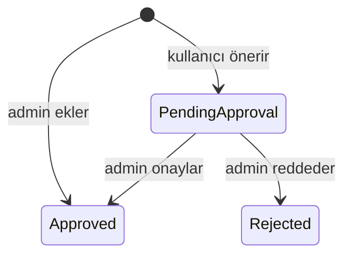
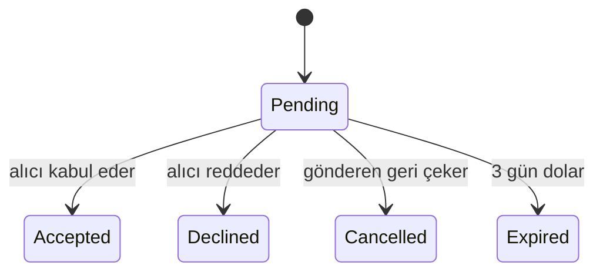
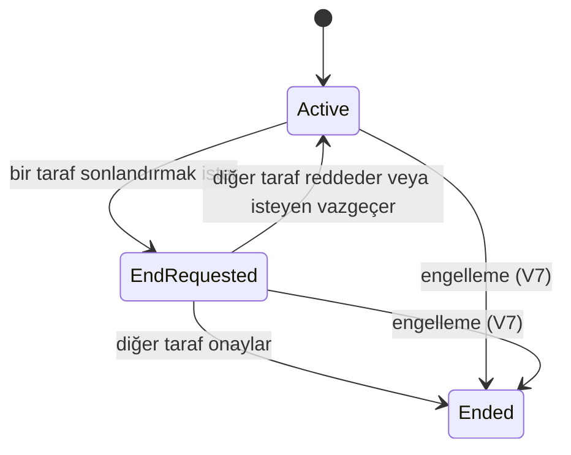
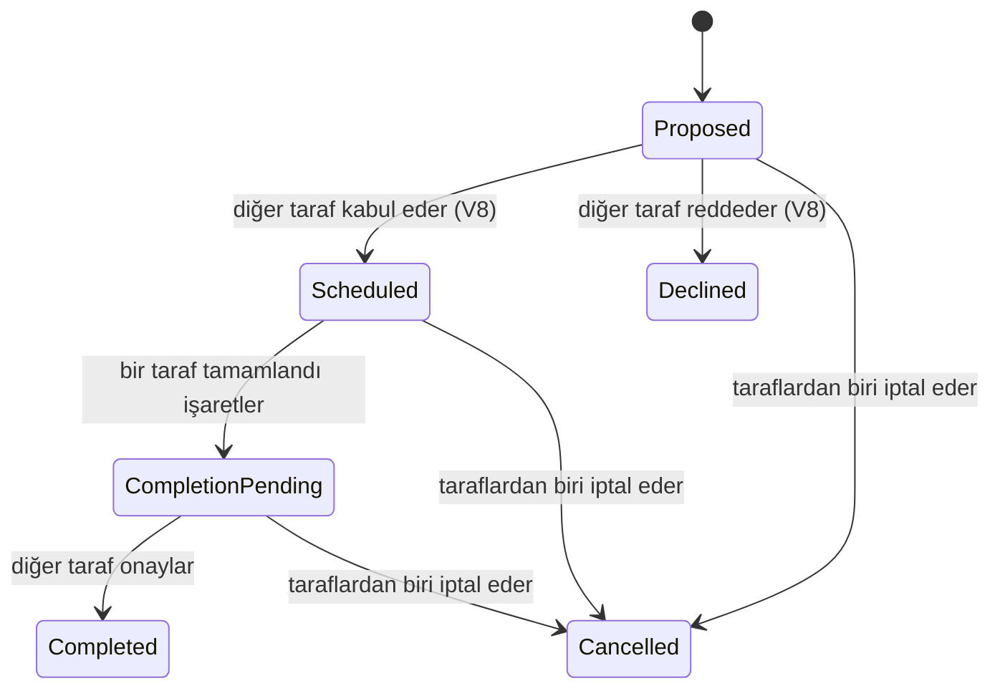

# Domain Modeli

Durum: **Taslak, onay bekliyor.** `(V#)` ile işaretli yerler henüz onaylanmamış varsayımlardır; numaralar `open-questions.md` dosyasındaki sorulara karşılık gelir.

Ortak kurallar:

- Tüm kimlikler `uuid`, tüm zamanlar UTC'dir.
- Bir modül başka bir modülün varlığını yalnızca kimliğiyle (`UserId`, `MatchId` ...) tanır. Modüller arası ilişkilerde navigation property yoktur.
- Her tablo tek bir modüle aittir. Başka modülün verisine ihtiyaç duyan modül, o modülün uygulama servisini çağırır veya domain event'ini dinler.

## 1. Identity

**`User`** (aggregate root)

| Alan | Açıklama |
|---|---|
| `Id` | |
| `Email` | Küçük harfe normalize edilir, benzersizdir. |
| `PasswordHash` | |
| `Status` | `Active`, `Suspended` |
| `Role` | `User`, `Admin` (V1) |
| `EmailVerifiedAt` | Boşsa e-posta doğrulanmamıştır. |
| `CreatedAt` | |

**`RefreshToken`** (User aggregate'inin parçası)

| Alan | Açıklama |
|---|---|
| `Id`, `UserId` | |
| `TokenHash` | Token'ın kendisi saklanmaz. |
| `FamilyId` | Aynı girişten türeyen token zinciri. Yeniden kullanım tespitinde tüm aile iptal edilir. |
| `ExpiresAt`, `CreatedAt`, `RevokedAt` | |
| `ReplacedByTokenId` | Rotasyonda yerine geçen token. |

**`OneTimeToken`**

| Alan | Açıklama |
|---|---|
| `Id`, `UserId` | |
| `Purpose` | `EmailVerification`, `PasswordReset` |
| `TokenHash`, `ExpiresAt`, `UsedAt` | Tek kullanımlıktır. |

## 2. Profiles

**`Profile`** (aggregate root, kullanıcı başına bir tane)

| Alan | Açıklama |
|---|---|
| `UserId` | Aynı zamanda birincil anahtar. |
| `DisplayName` | |
| `Bio` | |
| `AvatarKey` | Nesne depolamadaki anahtar. URL saklanmaz, istek anında presigned URL üretilir. |
| `City` | Koordinat tutulmaz. 81 ilden biri (V11). Boş olabilir. |
| `AcceptsOnline`, `AcceptsInPerson` | Takas tercihi; en az biri seçili olmalı (V10). |
| `CreatedAt`, `UpdatedAt` | |

## 3. Skills

**`SkillCategory`**: `Id`, `Name`, `Slug`, `SortOrder`.

**`Skill`** (aggregate root)

| Alan | Açıklama |
|---|---|
| `Id`, `CategoryId` | |
| `Name`, `Slug` | `Slug` benzersizdir; aynı yeteneğin iki kez önerilmesini engeller. |
| `Status` | `PendingApproval`, `Approved`, `Rejected` |
| `ProposedByUserId` | Kullanıcı önerisiyse dolu. |
| `CreatedAt`, `ReviewedAt` | |

**`UserSkill`**

| Alan | Açıklama |
|---|---|
| `Id`, `UserId`, `SkillId` | Yalnızca `Approved` yetenekler eklenebilir (V12). |
| `Type` | `Offered`, `Wanted` |
| `Level` | `Offered` için kullanıcının kendi seviyesi; `Wanted` için aradığı öğreticinin en düşük seviyesi. |
| `CreatedAt` | |

Bir kullanıcı aynı yeteneği yalnızca bir kez ekleyebilir; aynı yetenek hem sunulan hem istenen olamaz (V13).

## 4. Matching

**`SwapRequest`** (aggregate root)

| Alan | Açıklama |
|---|---|
| `Id` | |
| `RequesterId`, `RecipientId` | |
| `OfferedSkillId` | Gönderenin öğreteceği yetenek. Gönderenin sunduğu yeteneklerden biri olmalı. |
| `RequestedSkillId` | Gönderenin öğrenmek istediği yetenek. Alıcının sunduğu yeteneklerden biri olmalı. |
| `Status` | `Pending`, `Accepted`, `Declined`, `Cancelled`, `Expired` |
| `CreatedAt`, `ExpiresAt`, `RespondedAt` | `ExpiresAt = CreatedAt + 3 gün` |

Karşılıklı uyum şart değildir: `OfferedSkillId` alıcının istediği yetenekler arasında olmak zorunda değildir.

**`Match`** (aggregate root)

| Alan | Açıklama |
|---|---|
| `Id`, `SwapRequestId` | Her kabul edilen istek tek bir eşleşme üretir. |
| `UserAId`, `UserBId` | A isteği gönderen, B alan taraftır. |
| `SkillTaughtByAId`, `SkillTaughtByBId` | İstekten kopyalanır; istek sonradan değişmez ama eşleşme kendi başına okunabilir olmalı. |
| `Status` | `Active`, `EndRequested`, `Ended` |
| `EndRequestedByUserId`, `EndRequestedAt` | |
| `EndReason` | `MutualConsent`, `Blocked` (V7) |
| `CreatedAt`, `EndedAt` | |

## 5. Messaging

**`Conversation`** (aggregate root): `Id`, `MatchId` (benzersiz), `CreatedAt`. Eşleşme oluşunca otomatik açılır. Eşleşme sona erince salt okunur olur (V15).

**`ConversationParticipant`**: `ConversationId`, `UserId`, `LastReadAt`. Okunmamış mesaj sayısı için gerekir.

**`Message`**: `Id`, `ConversationId`, `SenderId`, `Body` (yalnızca metin), `SentAt`. Mesaj düzenlenmez ve silinmez.

## 6. Sessions

**`SwapSession`** (aggregate root)

| Alan | Açıklama |
|---|---|
| `Id`, `MatchId` | |
| `ProposedByUserId` | |
| `ScheduledAt`, `DurationMinutes` | |
| `Mode` | `Online`, `InPerson` (V10) |
| `Note` | Serbest metin: bağlantı, buluşma yeri vb. |
| `Status` | `Proposed`, `Scheduled`, `CompletionPending`, `Completed`, `Declined`, `Cancelled` |
| `CompletionMarkedByUserId`, `CompletedAt` | |
| `CancelledByUserId`, `CancelReason`, `CancelledAt` | `CancelReason` iptalde zorunludur. |
| `CreatedAt` | |

İptal tek taraflıdır ve sebep metni zorunludur. Sebep karşı tarafa bildirim olarak gider ve admin tarafından listelenebilir (V1).

## 7. Reviews

**`Review`** (aggregate root)

| Alan | Açıklama |
|---|---|
| `Id` | |
| `ReviewerId`, `RevieweeId` | Çift benzersizdir: bir kullanıcı diğerini yalnızca bir kez değerlendirir. |
| `SwapSessionId` | Değerlendirme hakkını doğuran tamamlanmış oturum. |
| `Rating` | 1–10 |
| `Comment` | İsteğe bağlı (V14). |
| `CreatedAt`, `DeletedAt` | Düzenlenemez. Yazarı silebilir; silme geri alınmaz. |

**`UserRatingSummary`**: `UserId`, `ReviewCount`, `AverageRating`. Silinmemiş değerlendirmelerden türetilir; keşfet sıralamasında ve profilde kullanılır.

## 8. Notifications

**`Notification`**: `Id`, `UserId`, `Type`, `Payload` (olaya özgü veri), `CreatedAt`, `ReadAt`.

**`Device`**: `Id`, `UserId`, `FcmToken` (benzersiz), `Platform` (`Android`, `Ios`, `Web`), `LastSeenAt`.

## 9. Moderation (V2)

Brief'teki sekiz modül arasında yoktur; ayrı modül olarak eklenmesi onay bekliyor.

**`Block`**: `BlockerId`, `BlockedId`, `CreatedAt`. Çift benzersizdir.

**`Report`**: `Id`, `ReporterId`, `TargetType` (`User`, `Message`, `Review`), `TargetId`, `Reason`, `Description`, `Status` (`Open`, `Resolved`, `Dismissed`), `CreatedAt`, `ResolvedAt`, `ResolvedByUserId`.

## 10. Modüller arası domain event'leri

| Event | Yayınlayan | Dinleyen ve etkisi |
|---|---|---|
| `UserRegistered` | Identity | Profiles: boş profil oluşturur. |
| `SkillProposalReviewed` | Skills | Notifications: öneren kullanıcıya sonuç bildirilir. |
| `SwapRequestSent` / `Accepted` / `Declined` / `Cancelled` / `Expired` | Matching | Notifications: ilgili tarafa bildirim. |
| `MatchCreated` | Matching | Messaging: sohbet açar. Notifications: iki tarafa bildirim. |
| `MatchEndRequested` | Matching | Notifications: karşı tarafa bildirim. |
| `MatchEnded` | Matching | Messaging: sohbeti salt okunur yapar. Sessions: tamamlanmamış oturumları iptal eder (V15). Notifications. |
| `MessageSent` | Messaging | Notifications: alıcı çevrimdışıysa push. |
| `SessionProposed` / `Scheduled` / `Declined` / `CompletionMarked` / `Completed` / `Cancelled` | Sessions | Notifications: karşı tarafa bildirim (iptalde sebep metniyle). |
| `ReviewCreated` / `ReviewDeleted` | Reviews | Notifications: değerlendirilen kullanıcıya bildirim (yalnızca oluşturmada). |
| `UserBlocked` | Moderation | Matching: aradaki bekleyen istekleri iptal eder, aktif eşleşmeyi sonlandırır (V7). |

Senkron sorgular (event değil, uygulama servisi çağrısı):

- Matching → Skills: yetenek gönderenin/alıcının sunduğu yetenekler arasında mı?
- Matching, Messaging, Sessions → Identity: kullanıcının e-postası doğrulanmış mı?
- Matching → Moderation: taraflar arasında engelleme var mı?
- Reviews → Sessions: iki kullanıcı arasında tamamlanmış oturum var mı?
- Keşfet (Matching) → Profiles, Skills, Reviews: listeleme verisi.
