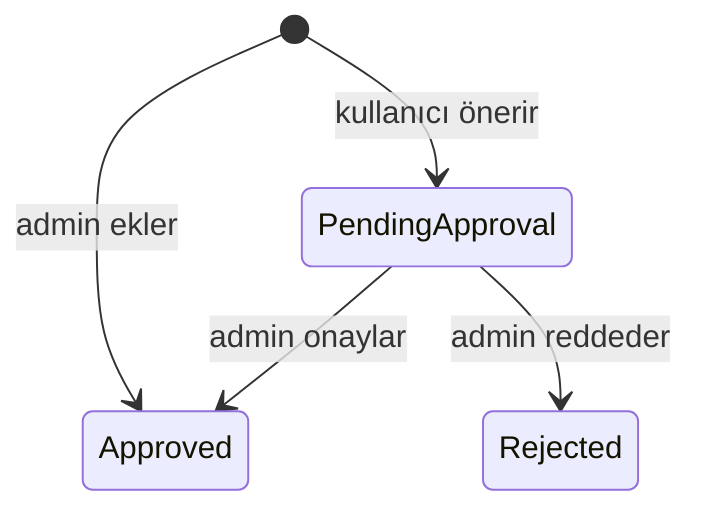
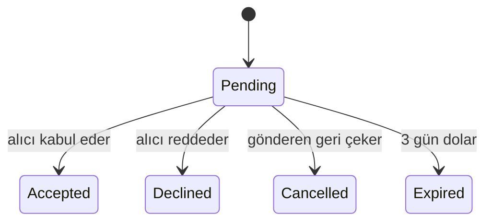
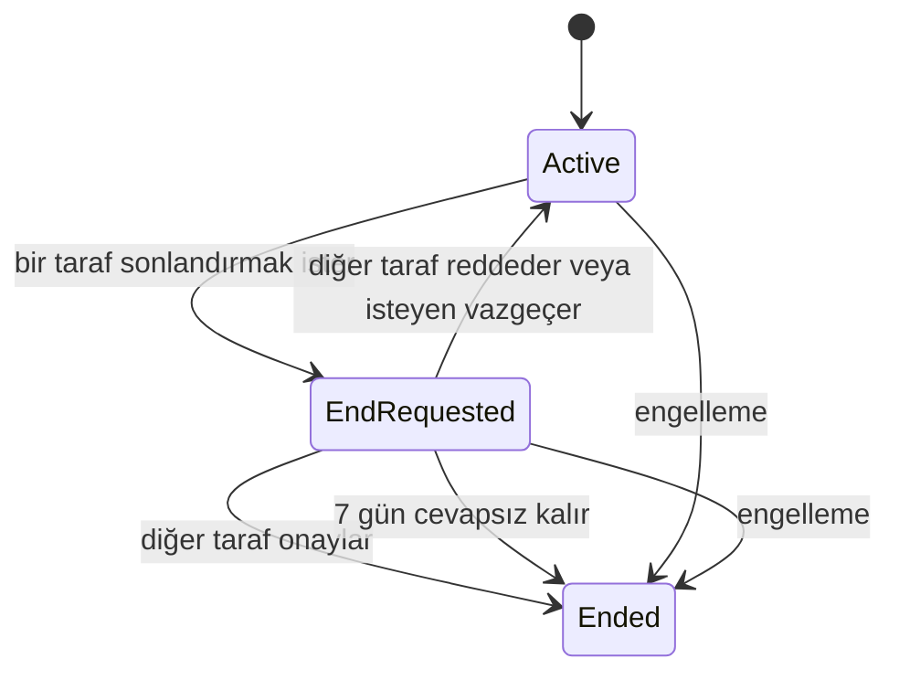
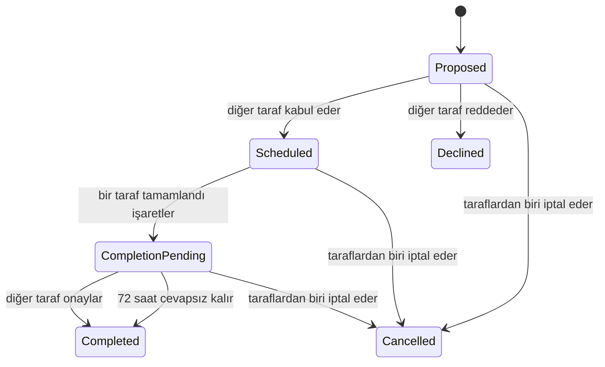

# Domain Modeli

Durum: **Onaylandı (2026-10-07).** Kararların dökümü `open-questions.md` dosyasındadır.

Ortak kurallar:

- Tüm kimlikler `uuid`, tüm zamanlar UTC'dir.
- Bir modül başka bir modülün varlığını yalnızca kimliğiyle (`UserId`, `MatchId` ...) tanır. Modüller arası ilişkilerde navigation property yoktur.
- Her tablo tek bir modüle aittir. Başka modülün verisine ihtiyaç duyan modül, o modülün uygulama servisini çağırır veya domain event'ini dinler.

## 1. Identity

**`User`** (aggregate root)

| Alan | Açıklama |
|---|---|
| `Id` | |
| `Email` | Küçük harfe normalize edilir, benzersizdir. Kalıcı silmede boşaltılır. |
| `Username` | Benzersiz kullanıcı adı; yalnızca küçük harf, rakam, alt çizgi ve nokta. Girişte e-posta yerine kullanılabilir, diğer kullanıcılara görünür ve değiştirilebilir. Kalıcı silmede boşaltılır. |
| `PasswordHash` | |
| `Status` | `Active`, `Suspended`, `PendingDeletion`, `Deleted` |
| `Role` | `User`, `Admin`. Admin işlemleri MVP'de arayüzsüz endpoint'lerle yapılır. |
| `EmailVerifiedAt` | Boşsa e-posta doğrulanmamıştır. |
| `UsernameChangedAt` | Kullanıcı adının son değiştirildiği an. Sonraki değişiklik 7 gün sonra yapılabilir. |
| `AgeConfirmedAt` | Kullanıcının 18 yaş ve üstü olduğunu onayladığı an. Kayıtta zorunludur; doğum tarihi tutulmaz. |
| `CreatedAt` | |
| `DeletionRequestedAt` | Silme isteğinin zamanı. 30 gün içinde giriş yapılırsa silme geri alınır. |
| `DeletedAt` | Kalıcı silmenin zamanı. |
| `DeletedEmailHash` | Kalıcı silmede e-posta silinir, yalnızca hash'i kalır. Aynı e-postayla yeniden kaydı 3 ay engellemek için tutulur, sonra temizlenir. |

**`RefreshToken`** (User aggregate'inin parçası)

| Alan | Açıklama |
|---|---|
| `Id`, `UserId` | |
| `TokenHash` | Token'ın kendisi saklanmaz. |
| `FamilyId` | Aynı girişten türeyen token zinciri. Yeniden kullanım tespitinde tüm aile iptal edilir. |
| `ExpiresAt`, `CreatedAt`, `RevokedAt` | |
| `ReplacedByTokenId` | Rotasyonda yerine geçen token. |

**`OneTimeToken`**

| Alan | Açıklama |
|---|---|
| `Id`, `UserId` | |
| `Purpose` | `EmailVerification`, `PasswordReset` |
| `TokenHash`, `ExpiresAt`, `UsedAt` | Tek kullanımlıktır. |

## 2. Profiles

**`Profile`** (aggregate root, kullanıcı başına bir tane)

| Alan | Açıklama |
|---|---|
| `UserId` | Aynı zamanda birincil anahtar. |
| `DisplayName` | |
| `Bio` | |
| `AvatarKey` | Nesne depolamadaki anahtar. URL saklanmaz, istek anında presigned URL üretilir. |
| `City` | Koordinat tutulmaz. 81 ilden biri. Boş olabilir. |
| `AcceptsOnline`, `AcceptsInPerson` | Takas tercihi; en az biri seçili olmalı. |
| `IsComplete` (türetilmiş) | Profil bilgileri (görünen ad ve en az bir takas tercihi) girilmişse doğrudur. Etkileşim için ayrıca en az bir sunulan yetenek ve doğrulanmış e-posta gerekir; bu birleşik koşul dilim 2'de modellenir. |
| `CreatedAt`, `UpdatedAt` | |

## 3. Skills

**`SkillCategory`**: `Id`, `Name`, `Slug`, `SortOrder`.

**`Skill`** (aggregate root)

| Alan | Açıklama |
|---|---|
| `Id`, `CategoryId` | |
| `Name`, `Slug` | `Slug` benzersizdir; aynı yeteneğin iki kez önerilmesini engeller. |
| `Status` | `PendingApproval`, `Approved`, `Rejected` |
| `ProposedByUserId` | Kullanıcı önerisiyse dolu. |
| `CreatedAt`, `ReviewedAt` | |

**`UserSkill`**

| Alan | Açıklama |
|---|---|
| `Id`, `UserId`, `SkillId` | Yalnızca `Approved` yetenekler eklenebilir. |
| `Type` | `Offered`, `Wanted` |
| `Level` | `Offered` için kullanıcının kendi seviyesi; `Wanted` için aradığı öğreticinin en düşük seviyesi. |
| `CreatedAt` | |

Bir kullanıcı aynı yeteneği her tipte en fazla bir kez ekleyebilir. Aynı yetenek hem sunulan hem istenen olabilir; bu durumda istenen seviye sunulan seviyeden yüksek olmalıdır. Sonuç olarak `Expert` seviyesinde sunulan bir yetenek aynı anda istenen olamaz.

## 4. Matching

**`SwapRequest`** (aggregate root)

| Alan | Açıklama |
|---|---|
| `Id` | |
| `RequesterId`, `RecipientId` | |
| `OfferedSkillId` | Gönderenin öğreteceği yetenek. Gönderenin sunduğu yeteneklerden biri olmalı. |
| `RequestedSkillId` | Gönderenin öğrenmek istediği yetenek. Alıcının sunduğu yeteneklerden biri olmalı. |
| `Status` | `Pending`, `Accepted`, `Declined`, `Cancelled`, `Expired` |
| `CreatedAt`, `ExpiresAt`, `RespondedAt` | `ExpiresAt = CreatedAt + 3 gün` |

Karşılıklı uyum şart değildir: `OfferedSkillId` alıcının istediği yetenekler arasında olmak zorunda değildir.

**`Match`** (aggregate root)

| Alan | Açıklama |
|---|---|
| `Id`, `SwapRequestId` | Her kabul edilen istek tek bir eşleşme üretir. |
| `UserAId`, `UserBId` | A isteği gönderen, B alan taraftır. |
| `SkillTaughtByAId`, `SkillTaughtByBId` | İstekten kopyalanır; istek sonradan değişmez ama eşleşme kendi başına okunabilir olmalı. |
| `Status` | `Active`, `EndRequested`, `Ended` |
| `EndRequestedByUserId`, `EndRequestedAt` | İstek 7 gün cevapsız kalırsa eşleşme kendiliğinden sonlanır. |
| `EndReason` | `MutualConsent`, `EndRequestExpired`, `Blocked`, `AccountDeleted` |
| `CreatedAt`, `EndedAt` | |

## 5. Messaging

**`Conversation`** (aggregate root)

| Alan | Açıklama |
|---|---|
| `Id` | |
| `UserLowId`, `UserHighId` | Sohbet eşleşmeye değil kullanıcı çiftine aittir; iki kullanıcı arasında tek sohbet olur. Kimlikler sıralı saklanır, böylece çift benzersizdir. |
| `CreatedAt` | İlk eşleşmede açılır. |
| `ClosedAt`, `ClosedByUserId` | Doluysa sohbet salt okunurdur. |

Eşleşme sona erince sohbet açık kalır ve iki taraf yazmaya devam edebilir. Aktif eşleşme yokken taraflardan biri sohbeti tek başına kapatabilir. Engelleme ve hesap silme de sohbeti kapatır. Aynı çift yeniden eşleşirse sohbet geçmişiyle birlikte yeniden açılır.

**`ConversationParticipant`**: `ConversationId`, `UserId`, `LastReadAt`. Okunmamış mesaj sayısı için gerekir.

**`Message`**: `Id`, `ConversationId`, `SenderId`, `Body` (yalnızca metin), `SentAt`. Mesaj düzenlenmez ve silinmez.

## 6. Sessions

**`SwapSession`** (aggregate root)

| Alan | Açıklama |
|---|---|
| `Id`, `MatchId` | |
| `ProposedByUserId` | |
| `ScheduledAt`, `DurationMinutes` | |
| `Mode` | `Online`, `InPerson` |
| `Note` | Serbest metin: bağlantı, buluşma yeri vb. |
| `Status` | `Proposed`, `Scheduled`, `CompletionPending`, `Completed`, `Declined`, `Cancelled` |
| `CompletionMarkedByUserId`, `CompletionMarkedAt` | İşaret 72 saat cevapsız kalırsa oturum kendiliğinden tamamlanmış sayılır. |
| `CompletedAt`, `CompletedAutomatically` | `CompletedAutomatically`, onayın süre dolduğu için sistemce verildiğini gösterir. |
| `CancelledByUserId`, `CancelReason`, `CancelledAt` | `CancelReason` iptalde zorunludur. |
| `CreatedAt` | |

İptal tek taraflıdır ve sebep metni zorunludur. Sebep karşı tarafa bildirim olarak gider ve admin tarafından listelenebilir.

## 7. Reviews

**`Review`** (aggregate root)

| Alan | Açıklama |
|---|---|
| `Id` | |
| `ReviewerId`, `RevieweeId` | Çift benzersizdir: bir kullanıcı diğerini yalnızca bir kez değerlendirir. |
| `SwapSessionId` | Değerlendirme hakkını doğuran tamamlanmış oturum. |
| `Rating` | 1–10 |
| `Comment` | İsteğe bağlı. |
| `CreatedAt`, `DeletedAt` | Düzenlenemez. Yazarı silebilir; silme geri alınmaz. |

**`UserRatingSummary`**: `UserId`, `ReviewCount`, `AverageRating`. Silinmemiş değerlendirmelerden türetilir; keşfet sıralamasında ve profilde kullanılır.

## 8. Notifications

**`Notification`**: `Id`, `UserId`, `Type`, `Payload` (olaya özgü veri), `CreatedAt`, `ReadAt`.

**`Device`**: `Id`, `UserId`, `FcmToken` (benzersiz), `Platform` (`Android`, `Ios`, `Web`), `LastSeenAt`.

## 9. Moderation

Dokuzuncu modül olarak 2026-10-07'de onaylandı (bkz. ADR 0001).

**`Block`**: `BlockerId`, `BlockedId`, `CreatedAt`. Çift benzersizdir.

**`Report`**: `Id`, `ReporterId`, `TargetType` (`User`, `Message`, `Review`), `TargetId`, `Reason`, `Description`, `Status` (`Open`, `Resolved`, `Dismissed`), `CreatedAt`, `ResolvedAt`, `ResolvedByUserId`.

## 10. Modüller arası domain event'leri

| Event | Yayınlayan | Dinleyen ve etkisi |
|---|---|---|
| `UserRegistered` | Identity | Profiles: boş profil oluşturur. Kayıt kaydedilmeden önce yayınlanır; profil hesapla aynı transaction'da oluşur. |
| `SkillProposalReviewed` | Skills | Notifications: öneren kullanıcıya sonuç bildirilir. |
| `SwapRequestSent` / `Accepted` / `Declined` / `Cancelled` / `Expired` | Matching | Notifications: ilgili tarafa bildirim. |
| `MatchCreated` | Matching | Messaging: çiftin sohbetini açar, kapalıysa yeniden açar. İstek sahibine bildirim, isteğin kabulüyle birlikte gider. |
| `MatchEndRequested` | Matching | Notifications: karşı tarafa bildirim. |
| `MatchEnded` | Matching | Sessions: tamamlanmamış oturumları iptal eder. Notifications: iki tarafa bildirim. Sohbet açık kalır. |
| `MessageSent` | Messaging | Notifications: alıcı çevrimdışıysa push. |
| `SessionProposed` / `Scheduled` / `Declined` / `CompletionMarked` / `Completed` / `Cancelled` | Sessions | Notifications: karşı tarafa bildirim (iptalde sebep metniyle). |
| `ReviewCreated` / `ReviewDeleted` | Reviews | Notifications: değerlendirilen kullanıcıya bildirim (yalnızca oluşturmada). |
| `UserBlocked` | Moderation | Matching: aradaki bekleyen istekleri iptal eder, aktif eşleşmeyi sonlandırır. Messaging: aradaki sohbeti kapatır. |
| `UserDeletionRequested` | Identity | Profiles: profili gizler. Matching: bekleyen istekleri iptal eder, aktif eşleşmeyi sonlandırır. Messaging: sohbetleri kapatır. |
| `UserDeletionCancelled` | Identity | Profiles: profili yeniden görünür yapar. |
| `UserDeleted` | Identity | Tüm modüller: kullanıcının verisini kalıcı olarak siler veya anonimleştirir. |

Senkron sorgular (event değil, uygulama servisi çağrısı):

- Matching → Skills: yetenek gönderenin/alıcının sunduğu yetenekler arasında mı?
- Matching, Messaging, Sessions → Identity: kullanıcının e-postası doğrulanmış mı?
- Matching → Moderation: taraflar arasında engelleme var mı?
- Reviews → Sessions: iki kullanıcı arasında tamamlanmış oturum var mı?
- Keşfet (Matching) → Profiles, Skills, Reviews: listeleme verisi.
