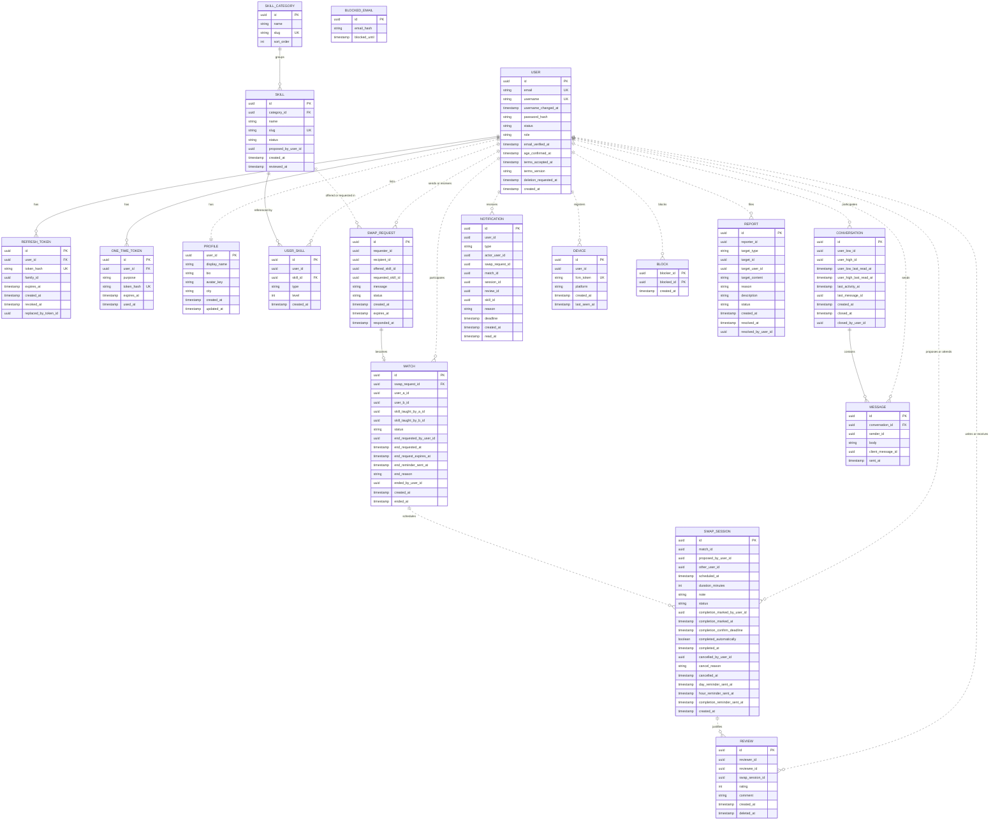

# ERD

Durum: **Onaylandı (2026-10-07); 2026-11-03'te migration'lardaki haliyle eşitlendi.** Alan açıklamaları için `docs/domain/domain-model.md` dosyasına bak.

Şemanın kaynağı EF Core migration'larıdır (`backend/src/Exparter.Infrastructure/Persistence/Migrations`); bu belge onların okunur özetidir. Her modülün tabloları kendi PostgreSQL şemasındadır (ör. `identity.users`, ADR 0006).

Farklı modüllerdeki tablolar arasındaki ilişkiler yalnızca kimlik referansıdır; kodda navigation property yoktur. Bu ilişkiler diyagramda kesikli çizgiyle gösterilir.

## Tablo sahipliği

| Modül (şema) | Tablolar |
|---|---|
| Identity (`identity`) | `users`, `refresh_tokens`, `one_time_tokens`, `blocked_emails` |
| Profiles (`profiles`) | `profiles` |
| Skills (`skills`) | `skill_categories`, `skills`, `user_skills` |
| Matching (`matching`) | `swap_requests`, `matches` |
| Messaging (`messaging`) | `conversations`, `messages` |
| Sessions (`sessions`) | `swap_sessions` |
| Reviews (`reviews`) | `reviews` |
| Notifications (`notifications`) | `notifications`, `devices` |
| Moderation (`moderation`) | `blocks`, `reports` |

Okuma durumu ayrı bir katılımcı tablosunda değil, sohbetin kendisinde tutulur; puan özeti tablo değildir, her okumada hesaplanır.

## Diyagram

## Benzersizlik kısıtları

İş kurallarını eşzamanlı isteklere karşı koruyan kısıtlar. Kural numaraları `docs/domain/business-rules.md` dosyasındandır.

| Tablo | Kısıt | Kural |
|---|---|---|
| `USER` | `email` benzersiz (küçük harfe normalize) | ID-01 |
| `USER` | `username` benzersiz | ID-15 |
| `SKILL` | `slug` benzersiz | SK-03 |
| `USER_SKILL` | (`user_id`, `skill_id`, `type`) benzersiz | SK-04 |
| `SWAP_REQUEST` | Sırasız kullanıcı çifti benzersiz, yalnızca `status = Pending` satırlarda (kısmi index) | RQ-05 |
| `MATCH` | `swap_request_id` benzersiz | MT-01 |
| `MATCH` | Sırasız kullanıcı çifti benzersiz, yalnızca `status <> Ended` satırlarda (kısmi index) | MT-02 |
| `CONVERSATION` | (`user_low_id`, `user_high_id`) benzersiz | MS-01 |
| `MESSAGE` | (`conversation_id`, `sender_id`, `client_message_id`) benzersiz | MS-11 |
| `REVIEW` | (`reviewer_id`, `reviewee_id`) benzersiz, silinmiş satırlar dahil | RV-01, RV-07 |
| `DEVICE` | `fcm_token` benzersiz | NT-10 |
| `BLOCK` | (`blocker_id`, `blocked_id`) birincil anahtar | — |
| `REPORT` | (`reporter_id`, `target_type`, `target_id`) benzersiz, yalnızca `status = Open` satırlarda | MD-08 |

Benzersizlik ihlali API'de iş kuralının hata koduna çevrilir (`UniqueConstraints`); böylece eşzamanlı iki istekten ikincisi 500 değil, kuralın 409'unu alır. Oturum çakışması (SS-20) için veritabanı kısıtı yoktur.

"Sırasız kullanıcı çifti", iki kimliğin küçüğü ve büyüğü üzerinden kurulan ifade index'idir; böylece A→B ve B→A aynı çift sayılır.

## Sorgu index'leri

Faz 6 dilim 4'te (performans) sorguların hepsinin index kullandığı doğrulandı. Benzersizlik index'lerine ek olarak:

- `users` (`deletion_requested_at`), yalnızca `PendingDeletion` satırlarda: kalıcı silme işi.
- `one_time_tokens` (`user_id`, `purpose`); `refresh_tokens` (`user_id`), (`family_id`); `blocked_emails` (`email_hash`).
- `skills` (`category_id`), (`status`, `category_id`); `user_skills` (`skill_id`, `type`): katalog ve keşfet.
- `swap_requests` (`recipient_id`, `created_at`), (`requester_id`, `created_at`), (`status`, `expires_at`): listeler ve süre aşımı.
- `matches` (`user_a_id`, `created_at`), (`user_b_id`, `created_at`), (`status`, `end_request_expires_at`).
- `conversations` (`user_low_id`, `last_activity_at`), (`user_high_id`, `last_activity_at`): sohbet listesi.
- `messages` (`conversation_id`, `sent_at`, `id`): cursor tabanlı sayfalama.
- `swap_sessions` (`match_id`, `created_at`), (`proposed_by_user_id`), (`other_user_id`), (`status`, `scheduled_at`), (`status`, `completion_confirm_deadline`).
- `reviews` (`reviewee_id`, `created_at`).
- `notifications` (`user_id`, `created_at`), (`created_at`): liste ve 90 günlük temizlik.
- `devices` (`user_id`); `blocks` (`blocked_id`); `reports` (`status`, `created_at`).
