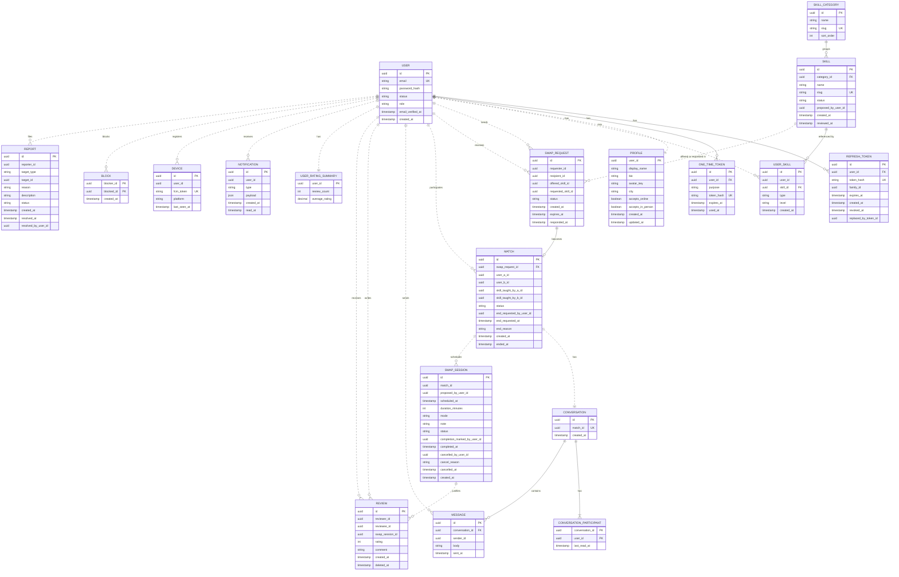

# ERD

Durum: **Taslak, onay bekliyor.** Alan açıklamaları için `docs/domain/domain-model.md` dosyasına bak.

Bu şema mantıksal modeldir. Tablo ve sütun adları, tipler ve index'ler Faz 3'te EF Core migration'larıyla kesinleşir.

Farklı modüllerdeki tablolar arasındaki ilişkiler yalnızca kimlik referansıdır; kodda navigation property yoktur. Bu ilişkiler diyagramda kesikli çizgiyle gösterilir.

## Tablo sahipliği

| Modül | Tablolar |
|---|---|
| Identity | `USER`, `REFRESH_TOKEN`, `ONE_TIME_TOKEN` |
| Profiles | `PROFILE` |
| Skills | `SKILL_CATEGORY`, `SKILL`, `USER_SKILL` |
| Matching | `SWAP_REQUEST`, `MATCH` |
| Messaging | `CONVERSATION`, `CONVERSATION_PARTICIPANT`, `MESSAGE` |
| Sessions | `SWAP_SESSION` |
| Reviews | `REVIEW`, `USER_RATING_SUMMARY` |
| Notifications | `NOTIFICATION`, `DEVICE` |
| Moderation (onay bekliyor) | `BLOCK`, `REPORT` |

## Diyagram

## Benzersizlik kısıtları

İş kurallarını eşzamanlı isteklere karşı koruyan kısıtlar. Kural numaraları `docs/domain/business-rules.md` dosyasındandır.

| Tablo | Kısıt | Kural |
|---|---|---|
| `USER` | `email` benzersiz (küçük harfe normalize) | ID-01 |
| `SKILL` | `slug` benzersiz | SK-03 |
| `USER_SKILL` | (`user_id`, `skill_id`) benzersiz | SK-04 |
| `SWAP_REQUEST` | Sırasız kullanıcı çifti benzersiz, yalnızca `status = Pending` satırlarda (kısmi index) | RQ-05 |
| `MATCH` | `swap_request_id` benzersiz | MT-01 |
| `MATCH` | Sırasız kullanıcı çifti benzersiz, yalnızca `status <> Ended` satırlarda (kısmi index) | MT-02 |
| `CONVERSATION` | `match_id` benzersiz | MS-01 |
| `REVIEW` | (`reviewer_id`, `reviewee_id`) benzersiz, silinmiş satırlar dahil | RV-01, RV-07 |
| `DEVICE` | `fcm_token` benzersiz | — |

"Sırasız kullanıcı çifti", iki kimliğin küçüğü ve büyüğü üzerinden kurulan ifade index'idir; böylece A→B ve B→A aynı çift sayılır.

## Sorgu index'leri (ilk tahmin)

Kesin liste Faz 6'daki performans kontrolünde gözden geçirilir.

- `USER_SKILL` (`skill_id`, `type`): keşfette "bu yeteneği sunanlar/isteyenler".
- `SWAP_REQUEST` (`recipient_id`, `status`) ve (`requester_id`, `status`): gelen/giden istek listeleri.
- `SWAP_REQUEST` (`expires_at`) yalnızca `Pending` satırlarda: süre aşımı taraması.
- `MATCH` (`user_a_id`), (`user_b_id`): eşleşme listesi.
- `MESSAGE` (`conversation_id`, `sent_at`, `id`): cursor tabanlı sayfalama.
- `SWAP_SESSION` (`match_id`, `scheduled_at`).
- `REVIEW` (`reviewee_id`, `created_at`).
- `NOTIFICATION` (`user_id`, `created_at`).
